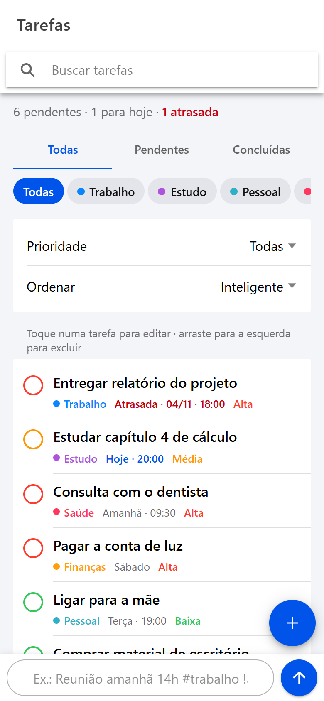
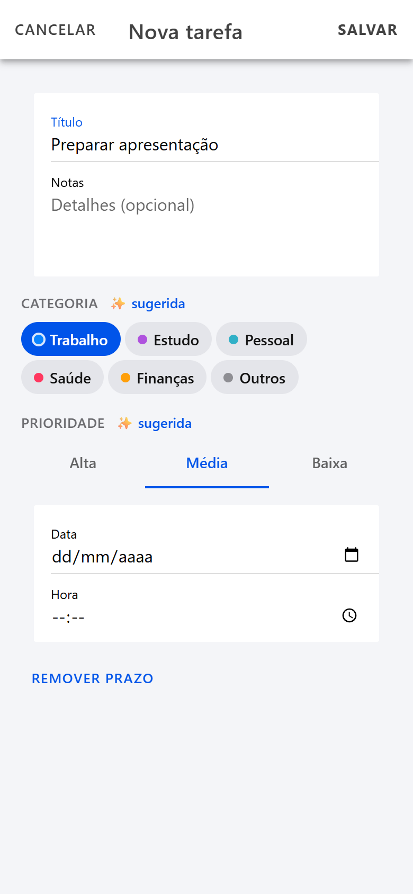

# Gerenciador de Tarefas Inteligente

Trabalho da disciplina **Explorando Tecnologias Móveis** — Universidade Comunitária da Região de Chapecó (Unochapecó).
Professor: **Cezar Junior de Souza**.

**Integrantes:** ______________________________________________

## Sobre o app

Aplicativo de tarefas com categorias, prioridades, busca e filtros, e um pouco de "inteligência": o texto
livre vira tarefa com prazo, categoria e prioridade. Roda no navegador, como PWA, e como app nativo
para **Android** (APK) e **iOS** (projeto Xcode) via Capacitor.

Tecnologia escolhida: **Ionic (HTML/CSS/JavaScript + Capacitor)**.

| Camada | Tecnologia |
|---|---|
| Interface | Ionic 8 (`@ionic/core`, web components) — JavaScript puro, sem framework |
| Build web | Vite 6 |
| App nativo | Capacitor 7 (Android e iOS) |
| Persistência | `@capacitor/preferences` (nativo) / `localStorage` (navegador) |
| Testes | `node --test` (módulo nativo do Node, sem dependência extra) |

- `appId`: `br.com.exemplo.tarefasinteligentes`
- Nome: `Gerenciador de Tarefas Inteligente`

## Funcionalidades (requisitos do TPE)

| Requisito do PDF | Como foi atendido | Onde está no código |
|---|---|---|
| Criar, editar e excluir tarefas | Formulário detalhado (botão **+**), edição tocando na tarefa, exclusão deslizando para a esquerda (ou pelo botão no formulário) | `src/store.js` (`add`, `update`, `remove`); `src/main.js` (`openSheet`, `saveForm`, `deleteTask`) |
| Categorizar (Trabalho, Estudo, Pessoal, etc.) | Seis categorias: Trabalho, Estudo, Pessoal, Saúde, Finanças, Outros | `src/smart.js` (`CATEGORIES`) |
| Prioridades (Alta, Média, Baixa) | Três níveis com cor e peso, usados na ordenação | `src/smart.js` (`PRIORITIES`) |
| Marcar como concluída | Toque no círculo ao lado da tarefa; a data de conclusão é guardada | `src/store.js` (`toggle`); `src/main.js` (evento `ionChange` da lista) |
| Buscar e filtrar | Busca sem diferenciar acento nem maiúscula; filtros por situação (Todas, Pendentes, Concluídas), categoria, prioridade e ordenação | `src/smart.js` (`fold`, `filterTasks`, `sortTasks`); `index.html` (`ion-searchbar`, `ion-segment`, `ion-select`) |
| Persistência local | Os dados ficam no aparelho (ou no navegador) e continuam após fechar o app | `src/storage.js`; `src/store.js` (`STORAGE_KEY`, `init`) |

### Extras "inteligentes"
- **Adição rápida em linguagem natural** (barra inferior). Exemplo: `Entregar relatório amanhã 14h #trabalho !alta`
  - datas: `hoje`, `amanhã`, `depois de amanhã`, dia da semana (`segunda`, `próxima sexta`), `dd/mm`, `dd/mm/aaaa`, `em 3 dias`
  - horário: `14h`, `14h30`, `14:30`
  - categoria: `#trabalho`, `#estudo`... ; prioridade: `!alta`, `!media`, `!baixa`
  - código: `src/smart.js` (`parseQuickAdd`)
- **Sugestão automática** de categoria e prioridade por palavras-chave e proximidade do prazo — tanto na adição rápida quanto no formulário (o usuário pode trocar). Código: `src/smart.js` (`suggest`, `inferCategory`, `inferPriority`).
- **Ordenação inteligente**: atrasadas primeiro, depois hoje, amanhã e os próximos 7 dias, ponderadas pela prioridade. Código: `src/smart.js` (`urgencyScore`, `sortTasks`).
- **Resumo no topo**: pendentes, para hoje e atrasadas. Código: `src/smart.js` (`summarize`).

## Telas

| Lista e resumo | Busca e filtro | Formulário |
|---|---|---|
|  |  |  |

Capturas em largura de celular (390 px), feitas com o servidor de desenvolvimento.

## Estrutura de pastas

```
.
├── index.html              tela única (cabeçalho, lista, barra de adição rápida, folha do formulário)
├── src/
│   ├── smart.js            regras puras: categorias, prioridades, datas, texto livre, sugestões, filtros, ordenação
│   ├── store.js            CRUD + validação + persistência (sem DOM)
│   ├── storage.js          adaptador: Capacitor Preferences (nativo) ou localStorage (navegador)
│   ├── main.js             interface: renderização e eventos
│   ├── ionic.js            inicialização do Ionic, toasts e alertas de confirmação
│   ├── pwa.js              registro do service worker (só na web)
│   └── styles.css          visual estilo iOS (claro/escuro, área segura)
├── tests/                  testes com node --test (regras, persistência e service worker)
├── public/                 manifest.webmanifest, sw.js (offline), ícones
├── resources/              ícone e splash de origem (para gerar os ícones nativos)
├── docs/screenshots/       capturas usadas neste README
├── android/                projeto Android nativo (Gradle) gerado pelo Capacitor
├── ios/                    projeto iOS nativo (Xcode) gerado pelo Capacitor
├── capacitor.config.json   appId, appName e pasta de build (dist)
├── vite.config.js          build e injeção do cache do service worker
└── package.json            scripts do projeto
```

`dist/` (build web), `node_modules/`, `android/app/build/` e `ios/App/Pods/` não vão para o repositório.

## Como rodar no navegador

Requisito: **Node.js 20 ou superior** (testado com Node 22).

```bash
npm install
npm run dev        # abre http://localhost:5173 (use o modo celular do DevTools)
```

Outros comandos:

```bash
npm test           # 27 testes das regras, da persistência e do service worker
npm run build      # gera o site estático em dist/
npm run preview    # serve o dist/ gerado, para conferir o build
```

## Modo offline

- Na **primeira visita** pela web, o `sw.js` guarda o app (HTML, CSS, JS e ícones) no cache. Depois disso ele abre sem internet.
- O `npm run build` coloca no cache a lista dos arquivos com hash (`vite.config.js`, plugin `precacheServiceWorker`).
- Os dados ficam no aparelho, então a lista continua disponível offline.
- No app nativo (Android/iOS) o app já vem empacotado: funciona offline desde a instalação, e o service worker não é usado.

## Android — gerar o APK

**Requisitos (Windows):**
1. **Node.js** LTS.
2. **JDK 21** (o Android Studio já traz um JDK; pode-se também instalar o Temurin 21).
3. **Android Studio** com o **Android SDK** instalado pelo SDK Manager: *Platform 35* e *Build-Tools* (o app compila com `compileSdk 35` e roda a partir do Android 6.0, `minSdk 23`).
4. Variáveis de ambiente: `JAVA_HOME` apontando para o JDK e `ANDROID_HOME` apontando para o SDK
   (ex.: `C:\Users\<usuario>\AppData\Local\Android\Sdk`).

**Passos:**

```bash
npm install
npm run android:sync        # npm run build + npx cap sync android
cd android
.\gradlew.bat assembleDebug   # ou, na raiz: npm run android:apk
```

APK gerado: `android/app/build/outputs/apk/debug/app-debug.apk`.

Para instalar: copie o `.apk` para o celular Android, abra o arquivo e permita "instalar apps desconhecidos",
ou use `adb install android/app/build/outputs/apk/debug/app-debug.apk` com depuração USB.

Para abrir o projeto no Android Studio: `npx cap open android`.

## iOS — gerar o app (requer Mac com Xcode)

O IPA só pode ser gerado em um **Mac com Xcode**. O projeto `ios/` já está no repositório.

```bash
npm install
npm run ios:sync            # npm run build + npx cap sync ios
npx cap open ios            # abre o Xcode
```

No Xcode:
1. Selecione o projeto **App → Signing & Capabilities** e escolha o seu *Team*.
2. Confira o *Bundle Identifier* (`br.com.exemplo.tarefasinteligentes`, igual ao `appId` do `capacitor.config.json`).
3. Escolha um iPhone (simulador ou aparelho) e clique em **Run**.

Para instalar em aparelho real com conta gratuita, a Apple exige assinatura com o Team; para a App Store é preciso a conta Apple Developer.
Sem Mac: é possível usar um build na nuvem com runner macOS (GitHub Actions, Codemagic, Bitrise) ou testar como PWA pelo Safari
(Compartilhar → Adicionar à Tela de Início), desde que a pasta `dist/` esteja publicada em HTTPS.

Depois de cada mudança no código: `npm run ios:sync` (ou `npm run android:sync`).

## Comandos resumidos

| Comando | O que faz |
|---|---|
| `npm install` | instala as dependências |
| `npm run dev` | servidor de desenvolvimento (navegador) |
| `npm test` | testes automatizados |
| `npm run build` | build web em `dist/` |
| `npm run android:sync` | build + copia para o projeto Android |
| `npm run android:apk` | build + sync + gera o APK de debug (Windows, precisa de JDK e SDK) |
| `npm run ios:sync` | build + copia para o projeto iOS (Mac) |
| `npx cap open android` / `npx cap open ios` | abre o projeto no Android Studio / Xcode |
